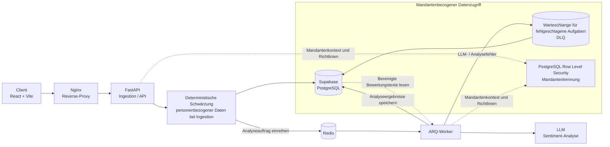

# Tenable | Enterprise SI & SERM Engine

🇬🇧 [English](README.md) | 🇷🇺 [Русский](README.ru.md) | 🇪🇸 [Español](README.es.md) | 🇨🇳 [简体中文](README.zh-CN.md) | 🇩🇪 [Deutsch](README.de.md)

Tenable ist eine B2B-Plattform für Sentiment Intelligence (SI) und Suchmaschinen-Reputationsmanagement (SERM), die rechtmäßig erhobene öffentliche Unternehmensbewertungen analysiert. Sie unterstützt Unternehmen dabei, Stimmungen zu verstehen, Risiken für die Servicequalität zu erkennen und Reputationsentwicklungen mit Mandantentrennung auszuwerten.

> **Projektstatus:** Dieses Repository enthält ein sich weiterentwickelndes MVP. Implementierungs- und Prüfstatus können sich je nach Funktion und Integration unterscheiden. Die Architektur und diese README sind keine Aussage über Produktionsreife. Prüfen Sie Bereitstellung, Integrationen, Sicherheitskontrollen und Betriebsabläufe in Ihrer eigenen Umgebung.

## Produktumfang

Tenable wandelt zur Verarbeitung freigegebene Bewertungsdaten in strukturierte Business Intelligence um:

- Klassifiziert Stimmungen und wiederkehrende Servicethemen.
- Hebt Rückmeldungen hervor, die zeitnahe menschliche Aufmerksamkeit erfordern könnten.
- Stellt autorisierten Unternehmensnutzern Trends und Analysen bereit.
- Unterstützt asynchrone Analyseprozesse, ohne API-Anfragen zu blockieren.

Tenable ist ein Analysewerkzeug. Es dient nicht der Manipulation von Reputation, verspricht nicht die Entfernung legitimer Bewertungen und veröffentlicht keine Antworten autonom.

## Datenschutz und Compliance

### Zulässige Nutzung und Datenquellen

Tenable ist **ausschließlich für rechtmäßige Sentiment-Intelligence- und Reputationsanalysen** vorgesehen. Das System ist weder für „Grauzonen“-Scraping noch für die Umgehung von Zugriffskontrollen oder eine Datenerhebung unter Verstoß gegen geltendes Recht, Plattformbedingungen oder vertragliche Beschränkungen konzipiert oder autorisiert.

Verwenden Sie ausschließlich Daten, die der Kunde verarbeiten darf, beispielsweise vom Kunden bereitgestellte Daten oder Daten aus einer ordnungsgemäß autorisierten offiziellen Integration. Vergewissern Sie sich vor der Aktivierung einer Quelle, dass sowohl die Quelle als auch die Erhebungsmethode zulässig sind. Die öffentliche Verfügbarkeit von Daten begründet für sich allein keine Rechtsgrundlage für deren Verarbeitung und setzt Plattformbedingungen nicht außer Kraft.

Die automatische Erhebung von öffentlichen Seiten ist im aktuellen Anwendungsablauf deaktiviert. Verfügbare Quellen und Integrationen können je nach Bereitstellung variieren. Prüfen Sie vor der Nutzung, welche Konfiguration tatsächlich aktiviert ist.

### Bereinigung personenbezogener Daten und Datenminimierung

Der Ingestion-Pfad für Bewertungstexte verwendet eine deterministische, codebasierte Schwärzung **bevor der Bewertungstext gespeichert oder für eine nachgelagerte LLM-Analyse bereitgestellt wird**. Die Bereinigung erkennt unterstützte Muster, darunter E-Mail-Adressen, Telefonnummern, lange numerische Kennungen sowie Namen, die konfigurierten Kontextmustern entsprechen. Für diese Schwärzung wird kein LLM verwendet.

Dies ist eine Maßnahme zur Datenminimierung und **keine Garantie für vollständige Anonymisierung oder die Erkennung sämtlicher personenbezogener Daten**. Die musterbasierte Erkennung kann unbekannte Formate, Namen ohne unterstützten Kontext oder andere sensible Informationen übersehen. Nicht-textuelle Bewertungsfelder und Quellmetadaten müssen gesondert betrachtet werden: Die Textbereinigung bereinigt nicht automatisch alle Kennungen, URLs, Metadatenfelder oder Integrationsdaten. Prüfen Sie, welche Felder in der eingesetzten Konfiguration gespeichert und übertragen werden, und übermitteln Sie keine Daten, die für die Analyse nicht erforderlich sind oder nicht rechtmäßig verarbeitet werden dürfen.

### Verantwortlichkeiten und rechtlicher Hinweis

Diese README beschreibt technische Kontrollen. Sie stellt weder eine Rechtsberatung noch eine Compliance-Zertifizierung oder eine Feststellung der Rechtmäßigkeit einer konkreten Verarbeitung dar. Der Kunde ist dafür verantwortlich, eine geeignete Rechtsgrundlage festzustellen und zu dokumentieren, erforderliche Hinweise bereitzustellen, die Rechte betroffener Personen zu wahren und sicherzustellen, dass Daten an Tenable und konfigurierte Unterauftragsverarbeiter weitergegeben werden dürfen. Der Betreiber muss seine eigenen Pflichten gesondert bewerten, darunter Sicherheit, Aufbewahrung, Zugriffskontrolle, Reaktion auf Sicherheitsvorfälle und etwaige internationale Datentransfers.

Prüfen Sie vor dem Produktiveinsatz das anwendbare Recht und die Plattformbedingungen, schließen Sie erforderliche vertragliche Vereinbarungen und bewerten Sie die Datenverarbeitungsbedingungen, Aufbewahrungsfristen und Verarbeitungsstandorte des konfigurierten LLM-Anbieters. Die rechtlichen Rollen des Kunden, des Betreibers und der Dienstleister hängen von der tatsächlichen Bereitstellung und Verarbeitung ab.

## Architektur

Das Diagramm zeigt den vorgesehenen Verarbeitungsablauf. RLS-Richtlinien begrenzen den mandantenbezogenen Datenzugriff auf Datenbankebene. Das Verhalten der Anwendung und der Worker muss für jede Bereitstellung ebenfalls konfiguriert und geprüft werden.

## Kernfunktionen

- **Mandantenübergreifende Datenisolierung:** PostgreSQL-Row-Level-Security-Richtlinien (RLS) beschränken Geschäftsdaten auf den authentifizierten Mandanten.
- **Deterministische Schwärzung personenbezogener Daten:** Unterstützte Muster werden während der Ingestion aus Bewertungstexten entfernt, bevor diese gespeichert oder einer LLM-Analyse zugeführt werden.
- **Asynchrone Verarbeitung:** Redis und ARQ-Worker verarbeiten Hintergrundaufgaben außerhalb des synchronen API-Anfragepfads.
- **Dead Letter Queue (DLQ):** Fehlgeschlagene KI-Analyseaufgaben können zur späteren Prüfung und kontrollierten Wiederaufnahme gespeichert werden, statt unbemerkt verworfen zu werden.
- **Strukturierte KI-Analyse:** Stimmungs- und Problemklassifizierungen werden anhand typisierter Modelle validiert.
- **Betriebliche Schutzmaßnahmen:** Die Codebasis enthält Komponenten für Mandantenkontext, Request-Tracing, Ratenbegrenzung, Wiederholungsversuche und Kontingente. Konfiguration und Verifikation sind für jede Bereitstellung gesondert erforderlich.

## Technologie-Stack

| Bereich | Technologien |
|---|---|
| **Frontend** | React 18, TypeScript, Vite, Zustand |
| **Backend-API** | Python 3.10+, FastAPI, Pydantic |
| **Datenbank** | Supabase-gehostetes PostgreSQL, PostgreSQL RLS |
| **Asynchrone Verarbeitung** | Redis, ARQ |
| **KI-Analyse** | LLM-Integration über den konfigurierten Anbieter; Verhalten und Bedingungen hängen von der Bereitstellung ab |
| **Web / Laufzeit** | Nginx, Docker, Docker Compose |
| **Abrechnungskomponenten** | Das Repository enthält Stripe-Integrationskomponenten; diese müssen separat aktiviert und geprüft werden |

## Sicherheit und Betrieb

- Das Mandantentrennungsmodell der Anwendung erfordert PostgreSQL. SQLite ersetzt keine Prüfung des RLS-Verhaltens.
- Wenden Sie Datenbankmigrationen mit dem Migrationsskript des Repositorys an, statt Migrationsdateien manuell auszuführen. Siehe [`migrations/README.md`](migrations/README.md).
- Schützen Sie Geheimnisse und Zugangsdaten mit der Secret-Verwaltung Ihrer Bereitstellungsumgebung. Committen Sie keine `.env`-Dateien oder Produktionszugangsdaten.
- Prüfen Sie vor dem Produktiveinsatz aktivierte Integrationen, Mandantenrollen, Netzwerkzugriff, Datenbankrichtlinien, LLM-Konfiguration, Protokollierung und Aufbewahrungseinstellungen.
- Behandeln Sie die DLQ als betrieblich sensible Datenablage. Beschränken Sie den Zugriff und definieren Sie geeignete Aufbewahrungs- und Wiederholungsverfahren.

## Repository-Dokumentation

- [`README.md`](README.md) — Hauptversion auf Englisch.
- [`frontend/README.md`](frontend/README.md) — Dokumentation zum Frontend.
- [`migrations/README.md`](migrations/README.md) — Anleitung zu Datenbankmigrationen.
- [`infra/devops/README.md`](infra/devops/README.md) — DevOps- und Bereitstellungsdokumentation.

## Lizenz

Diese README räumt keine Lizenzrechte ein. Die geltenden Bedingungen sind, sofern vorhanden, der Lizenzdatei des Repositorys zu entnehmen.
