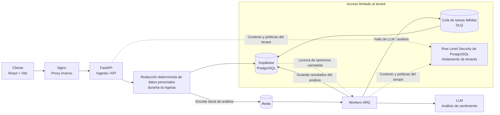

# Tenable | Enterprise SI & SERM Engine

[](https://www.python.org/)
[](https://fastapi.tiangolo.com/)
[](https://www.typescriptlang.org/)
[](https://react.dev/)
[](https://supabase.com/)

🇬🇧 [English](README.md) | 🇷🇺 [Русский](README.ru.md) | 🇪🇸 [Español](README.es.md) | 🇨🇳 [简体中文](README.zh-CN.md) | 🇩🇪 [Deutsch](README.de.md)

Tenable es una plataforma B2B de Sentiment Intelligence (SI) y gestión de la reputación en buscadores (SERM) para analizar opiniones públicas sobre empresas obtenidas de forma lícita. Ayuda a las organizaciones a comprender el sentimiento, detectar riesgos relacionados con la calidad del servicio y seguir la evolución de su reputación mediante análisis con aislamiento entre tenants.

> **Estado del proyecto:** Este repositorio contiene un MVP en evolución. El grado de implementación y verificación puede variar entre funciones e integraciones. La arquitectura y este README no deben interpretarse como una declaración de preparación para producción. Valide el despliegue, las integraciones, los controles de seguridad y los procedimientos operativos en su propio entorno.

## Alcance del producto

Tenable está diseñado para convertir datos de opiniones cuyo tratamiento está autorizado en inteligencia empresarial estructurada:

- Clasifica el sentimiento y los temas recurrentes relacionados con el servicio.
- Señala opiniones que pueden requerir atención humana oportuna.
- Presenta tendencias y análisis a usuarios autorizados de la empresa.
- Admite cargas de análisis asíncronas sin bloquear las solicitudes de la API.

Tenable es una herramienta de análisis. No es un servicio para manipular la reputación, no promete eliminar opiniones legítimas y no publica respuestas de forma autónoma.

## Privacidad de datos y cumplimiento

### Uso permitido y fuentes de datos

Tenable está destinado **exclusivamente al análisis lícito de sentimiento (Sentiment Intelligence) y reputación**. No está diseñado ni autorizado para realizar scraping «gris», eludir controles de acceso o recopilar datos infringiendo la legislación aplicable, las condiciones de las plataformas o las restricciones contractuales.

Utilice únicamente datos cuyo tratamiento esté autorizado para el cliente, por ejemplo, datos proporcionados por el propio cliente u obtenidos mediante una integración oficial debidamente autorizada. Antes de habilitar una fuente, confirme que tanto la fuente como el método de recopilación están permitidos. Que los datos sean públicos no establece por sí solo una base jurídica para su tratamiento ni invalida las condiciones de la plataforma.

La recopilación automática desde páginas públicas está deshabilitada en el flujo actual de la aplicación. Las integraciones disponibles pueden variar según el despliegue; verifique la configuración realmente habilitada antes de utilizarlas.

### Saneamiento de datos personales y minimización

El flujo de ingesta del texto de las opiniones aplica una redacción determinista basada en código **antes de guardar el texto y antes de ponerlo a disposición del análisis posterior mediante LLM**. El saneador detecta patrones compatibles, incluidos correos electrónicos, números de teléfono, identificadores numéricos largos y nombres que coinciden con patrones contextuales configurados. La redacción no depende de un LLM.

Esta es una medida de minimización de datos, **no una garantía de anonimización completa ni de detección de todos los datos personales**. La detección basada en patrones puede no reconocer formatos no contemplados, nombres sin el contexto compatible u otra información sensible. Revise por separado los campos no textuales de las opiniones y los metadatos de origen: sanear el texto no limpia automáticamente todos los identificadores, URL, campos de metadatos o cargas útiles de integraciones. Verifique qué campos se guardan y transmiten en la configuración desplegada y no envíe datos que no sean necesarios o cuyo tratamiento no esté autorizado.

### Responsabilidades y aviso legal

Este README describe controles técnicos; no constituye asesoramiento jurídico, una certificación de cumplimiento ni una determinación de que un tratamiento concreto sea lícito. El cliente es responsable de establecer y documentar una base jurídica adecuada, proporcionar los avisos exigidos, respetar los derechos de los interesados y asegurarse de que puede compartir los datos enviados con Tenable y con los subencargados configurados. El operador debe evaluar por separado sus propias obligaciones, incluidas la seguridad, la conservación, el control de acceso, la respuesta a incidentes y las posibles transferencias internacionales de datos.

Antes de utilizar el sistema en producción, revise la legislación aplicable y las condiciones de las plataformas, formalice los acuerdos contractuales necesarios y evalúe las condiciones de tratamiento, la conservación y las ubicaciones de procesamiento del proveedor de LLM configurado. Las funciones jurídicas del cliente, del operador y de los proveedores dependen del despliegue y del tratamiento reales.

## Arquitectura



El diagrama representa el flujo previsto. Las políticas RLS limitan el acceso a los datos en la base de datos; el comportamiento de la aplicación y de los workers también debe configurarse y probarse en cada despliegue.

## 🖥️ Arquitectura frontend e ingeniería del cliente

El cliente de página única está construido con React 18, TypeScript y Vite. El código fuente se encuentra en `frontend/src/`:

```text
frontend/src/
├── api/          # Cliente Axios, servicios de API y gestión de errores
├── components/   # Primitivas de interfaz compartidas y límite global de errores
├── features/     # Módulos de autenticación, panel, opiniones y facturación
├── hooks/        # Hooks reutilizables del cliente
├── pages/        # Pantallas asociadas a rutas
├── store/        # Estado de la aplicación con Zustand y persistencia
├── types/        # Tipos compartidos de TypeScript
├── App.tsx
├── main.tsx      # Punto de entrada de React y configuración de rutas
└── index.css     # Estilos globales y base de Tailwind CSS
```

- **Enrutamiento y acceso:** React Router define rutas públicas y protegidas. `ProtectedRoute` protege las pantallas restringidas, pero la autorización también debe aplicarse en el backend.
- **Gestión del estado (State Management):** Zustand gestiona el estado compartido de la aplicación con persistencia. Las llamadas a la API se centralizan en `api/`; el cliente Axios normaliza los errores y coordina las cuotas y los límites de frecuencia.
- **Seguridad del cliente Zero Trust:** el navegador se considera un entorno no confiable. Las protecciones de rutas en el cliente mejoran la navegación, pero no sustituyen la autorización del backend ni el aislamiento de tenants en la base de datos. No confíe al cliente la protección de secretos ni la aplicación del control de acceso.
- **Interfaz basada en componentes (Component-Driven UI):** los componentes de interfaz compartidos están en `components/`, mientras que las pantallas y la lógica específicas se organizan en `features/`. Tailwind CSS v3 y la configuración del tema proporcionan clases de utilidad y tokens de diseño.
- **Interfaz optimista (Optimistic UI):** para interacciones reversibles adecuadas, actualice la interfaz antes de que termine la solicitud; después, sincronícela con la respuesta del servidor y restaure el estado anterior si la solicitud falla.
- **Comprobaciones del cliente:** desde `frontend/`, ejecute `npm run lint`, `npm run typecheck`, `npm run test:run` y `npm run build` para el análisis estático, la comprobación de tipos, las pruebas y la compilación de producción.

## Funciones principales

- **Aislamiento de datos multi-tenant:** las políticas de PostgreSQL Row Level Security (RLS) limitan los registros empresariales al tenant autenticado.
- **Redacción determinista de datos personales:** los patrones compatibles se redactan del texto de las opiniones durante la ingesta, antes de guardarlo y antes del análisis mediante LLM.
- **Procesamiento asíncrono:** Redis y los workers ARQ procesan tareas en segundo plano, fuera del ciclo síncrono de la API.
- **Dead Letter Queue (DLQ):** las tareas fallidas de análisis de IA pueden registrarse para su revisión y recuperación controlada, en lugar de descartarse silenciosamente.
- **Análisis de IA estructurado:** las clasificaciones de sentimiento y de incidencias se validan mediante modelos tipados.
- **Controles operativos:** el código incluye componentes para el contexto del tenant, el rastreo de solicitudes, la limitación de frecuencia, los reintentos y las cuotas. Su configuración y verificación dependen de cada despliegue.

## Tecnologías

| Área | Tecnologías |
|---|---|
| **Frontend** | React 18, TypeScript, Vite, Zustand |
| **API backend** | Python 3.10+, FastAPI, Pydantic |
| **Base de datos** | PostgreSQL alojado en Supabase, PostgreSQL RLS |
| **Procesamiento asíncrono** | Redis, ARQ |
| **Análisis de IA** | Integración con LLM mediante el proveedor configurado; el comportamiento y las condiciones dependen del despliegue |
| **Web / ejecución** | Nginx, Docker, Docker Compose |
| **Componentes de facturación** | El repositorio contiene componentes de integración con Stripe; habilítelos y valídelos por separado |

## Seguridad y operación

- El modelo de aislamiento de tenants de la aplicación requiere PostgreSQL; SQLite no sustituye la validación del comportamiento de RLS.
- Aplique las migraciones mediante el ejecutor de migraciones del repositorio, en lugar de ejecutar archivos de migración manualmente. Consulte [`migrations/README.md`](migrations/README.md).
- Proteja secretos y credenciales mediante la gestión de secretos del entorno de despliegue. No incluya archivos `.env` ni credenciales de producción en commits.
- Antes de producción, revise las integraciones habilitadas, los roles de tenant, el acceso de red, las políticas de la base de datos, la configuración de LLM, los registros y la retención.
- Trate la DLQ como un almacén de datos sensibles desde el punto de vista operativo. Restrinja el acceso y defina procedimientos de retención y repetición adecuados.

## Documentación del repositorio

- [`README.md`](README.md) — versión principal en inglés.
- [`frontend/README.md`](frontend/README.md) — documentación específica del frontend.
- [`migrations/README.md`](migrations/README.md) — guía de migraciones de base de datos.
- [`infra/devops/README.md`](infra/devops/README.md) — documentación de DevOps y despliegue.

## Licencia

Este README no concede derechos de licencia. Consulte el archivo de licencia del repositorio, si existe, para conocer las condiciones aplicables.
