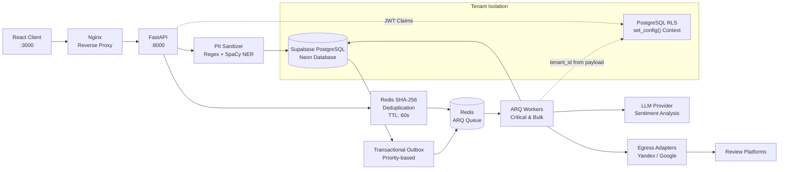

# SentiGuard

[](https://www.python.org/)
[](https://fastapi.tiangolo.com/)
[](https://react.dev/)
[](https://www.typescriptlang.org/)
[](https://vite.dev/)
[](https://zustand.docs.pmnd.rs/)
[](https://tailwindcss.com/)
[](https://supabase.com/)
[](https://redis.io/)

🇬🇧 [English](README.md) | 🇷🇺 [Русский](docs/README.ru.md) | 🇪🇸 [Español](docs/README.es.md) | 🇨🇳 [简体中文](docs/README.zh-CN.md) | 🇩🇪 [Deutsch](docs/README.de.md)

SentiGuard is a multi-tenant B2B Sentiment Intelligence (SI) and Search Engine Reputation Management (SERM) platform. It transforms lawfully obtained public business feedback into structured analytics with tenant isolation, PII protection, and asynchronous AI processing.

> **⚠️ Production Notice:** This is an evolving MVP. Validate deployment, security controls, integrations, and operational procedures before production use.

---

## 🎯 Product Scope

SentiGuard converts authorized review data into actionable business intelligence:

- **Sentiment Classification** – Classify reviews as POSITIVE, NEGATIVE, or NEUTRAL
- **Theme Extraction** – Identify recurring service issues (quality, support, onboarding)
- **Risk Detection** – Highlight feedback requiring timely human attention
- **Trend Analytics** – Present reputation trends and metrics to authorized users
- **Async Processing** – LLM analysis runs outside request-response path via background workers
- **Human-in-the-Loop** – All AI-generated replies require explicit moderation before publication

SentiGuard is an analytics tool, not a reputation-manipulation service. It does not promise review removal or publish replies without human approval.

---

## 🔒 Data Privacy & Compliance

### Permitted Use & Data Sources

SentiGuard is **exclusively for lawful Sentiment Intelligence and reputation analytics**. It is not authorized for gray scraping, access-control circumvention, or data collection violating applicable law or platform terms.

Use only data that the customer is authorized to process (customer-supplied or via authorized official integration). Public availability alone does not establish lawful processing.

### PII Sanitization

The review-text ingestion path applies **deterministic, code-based redaction** before persistence and LLM analysis:

- **Regex Fallback** – Targets email, phone, credit cards, long numeric IDs, Russian vehicle plates, document numbers, social handles
- **SpaCy NER (Optional)** – Named Entity Recognition for enhanced PII detection with concurrency protection
- **SHA-256 Author Hashing** – Stable pseudonyms for author identification without exposing raw IDs

**This is a data-minimization safeguard, not a guarantee of complete anonymization.** Pattern-based detection can miss unrecognized formats. Validate all stored fields before production.

### Responsibilities

This README describes technical controls, not legal advice. Customers are responsible for:
- Establishing a lawful basis for processing
- Providing required notices
- Respecting data-subject rights
- Ensuring data may be shared with subprocessors
- Assessing LLM provider data-processing terms and retention

---

## 🏗️ Architecture

### System Overview



### Backend Architecture (FastAPI)

**Three-Layer Architecture:**

```
app/
├── api/                    # API Layer
│   ├── v1/routes/         # Route handlers (auth, reviews, analytics, etc.)
│   ├── schemas/           # Pydantic request/response models
│   ├── dependencies/      # FastAPI dependencies (auth, tenant, idempotency)
│   └── errors/            # Custom exception handlers
├── application/           # Application Service Layer
│   ├── reviews/           # Review business logic
│   └── economics/         # Economic calculations
├── infrastructure/        # Infrastructure Layer
│   ├── persistence/       # SQLAlchemy models
│   ├── repositories/      # Data access patterns
│   ├── queue/             # ARQ worker configuration
│   └── integrations/      # External platform adapters
├── core/                  # Core Services
│   ├── database.py        # AsyncSession, engine, DB session manager
│   ├── tenant_session.py  # RLS context management
│   ├── redis.py           # Redis/ARQ pool
│   ├── pii.py             # Regex PII sanitizer
│   ├── spacy_pii.py       # SpaCy NER-based sanitizer
│   ├── llm_reply_generator.py  # AI reply generation
│   └── auth.py            # JWT handling
└── workers/               # Background workers
    ├── outbox_worker.py   # Outbox event processor
    └── tasks/             # Worker task definitions
```

**Key Patterns:**

- **Tenant Isolation via RLS** – `set_tenant_rls_context()` sets PostgreSQL session variables for Row Level Security
- **Transactional Outbox** – Domain changes and outbox events are committed atomically
- **Priority-based Workers** – Separate Critical (Q1) and Bulk (Q2) worker pools with `FOR UPDATE SKIP LOCKED`
- **Early Session Release** – `DatabaseSessionManager` closes DB connections before heavy I/O/LLM operations
- **SHA-256 Deduplication** – Redis-based idempotency with 60-second TTL prevents duplicate review ingestion

### Frontend Architecture (React + TypeScript)

```
frontend/src/
├── api/                   # API Layer
│   ├── client.ts         # Axios client with interceptors
│   ├── services.ts       # Type definitions & API functions
│   ├── openapi-client.ts # OpenAPI-generated typed client
│   └── schema.d.ts       # Auto-generated from backend OpenAPI
├── components/           # Shared UI primitives
│   └── ui/               # Radix UI + Tailwind components
├── features/             # Feature modules
│   ├── auth/             # Authentication flow
│   ├── reviews/          # Review list, card, table
│   └── dashboard/        # Dashboard overview
├── hooks/                # Custom React hooks
│   ├── api/              # TanStack Query hooks
│   ├── useArchiveReview.ts  # Optimistic archive mutation
│   └── useSubmitReview.ts   # Manual review submission
├── pages/                # Route-level screens
├── store/                # Zustand state management
└── lib/                  # Utilities (react-query config)
```

**Key Patterns:**

- **TanStack Query v5** – Server state management with optimistic mutations
- **React Virtual** – List virtualization for large datasets (5,000+ items)
- **Optimistic Updates** – Immediate cache updates with rollback on failure
- **Zustand** – UI-only state (separate from server state)
- **Strict B2B Design** – ink/chrome/plum/lime palette, no shadows/gradients, `rounded-none`
- **OpenAPI Sync** – `openapi-typescript` generates frontend types from backend

---

## 🛠️ Technology Stack

### Backend

| Component | Technology |
|-----------|------------|
| **Framework** | FastAPI 0.104+ |
| **Python** | 3.11+ |
| **Database** | Supabase PostgreSQL (Neon-compatible) |
| **ORM** | SQLAlchemy 2.0 (async) |
| **Async Driver** | asyncpg |
| **Task Queue** | ARQ (Redis-based) |
| **Redis** | Redis 5.0+ |
| **Auth** | Supabase Auth + JWT |
| **PII Sanitization** | Regex patterns + SpaCy NER |
| **LLM Integration** | OpenAI-compatible async client |
| **Web Server** | Uvicorn |
| **Admin Panel** | SQLAdmin |

### Frontend

| Component | Technology |
|-----------|------------|
| **Framework** | React 18 |
| **Language** | TypeScript 5.3+ |
| **Build Tool** | Vite 5.0+ |
| **State Management** | Zustand 4.4+ |
| **Server State** | TanStack Query 5.105+ |
| **Virtualization** | @tanstack/react-virtual 3.14+ |
| **Routing** | React Router 6.30+ |
| **Forms** | React Hook Form 7.91+ |
| **Validation** | Zod 4.6+ |
| **HTTP Client** | Axios 1.20+ |
| **Styling** | Tailwind CSS 3.3+ |
| **UI Components** | Radix UI + shadcn/ui patterns |
| **Notifications** | Sonner |
| **Error Handling** | react-error-boundary |
| **OpenAPI** | openapi-typescript + openapi-fetch |

---

## 🔐 Security & Operational Safeguards

### Database Security

- **PostgreSQL RLS** – Row Level Security policies enforce tenant isolation at database layer
- **NullPool + PgBouncer** – Connection pooling compatibility with prepared statement cache disabled
- **Separate Roles** – `postgres` for migrations, tenant-specific role for runtime
- **Transaction Isolation** – All writes use explicit transactions

### API Security

- **JWT Authentication** – Supabase JWT with tenant claims
- **Rate Limiting** – Per-endpoint rate limiting with Redis
- **Quota Enforcement** – Tenant-level quota checks before resource-intensive operations
- **CORS** – Configured for localhost:3000 and 127.0.0.1:3000
- **Idempotency** – SHA-256-based deduplication for review ingestion

### Data Protection

- **PII Redaction** – Ingestion pipeline redacts patterns before persistence
- **Author Hashing** – SHA-256 HMAC with salt for stable pseudonyms
- **Encrypted Credentials** – Fernet encryption for platform OAuth tokens
- **Logging** – Structured logging with correlation IDs (no secrets in logs)

### Worker Reliability

- **Transactional Outbox** – Events committed atomically with domain changes
- **Priority Queues** – Critical (Q1) events processed before Bulk (Q2)
- **Row Locking** – `FOR UPDATE SKIP LOCKED` prevents worker contention
- **Dead Letter Queue** – Failed tasks persisted for inspection/recovery
- **Retries** – Tenacity-based retry logic for transient failures

---

## 🚀 Getting Started

### Prerequisites

- Python 3.11+
- Node.js 18+
- PostgreSQL (Supabase or Neon)
- Redis
- Supabase project (for Auth)

### Backend Setup

```bash
# 1. Clone repository
git clone <repo-url>
cd SentiGuard

# 2. Install Python dependencies
pip install -e ".[dev]"

# 3. Configure environment
cp .env.example .env
# Edit .env with DATABASE_URL, REDIS_URL, SUPABASE_URL, SUPABASE_SERVICE_ROLE_KEY

# 4. Run migrations
alembic upgrade head

# 5. Seed demo data
python scripts/seed_demo.py --create-tenant

# 6. Start backend
uvicorn app.main:app --reload --host 0.0.0.0 --port 8000
```

### Frontend Setup

```bash
# 1. Install dependencies
cd frontend
npm install

# 2. Generate OpenAPI types (backend must be running)
npm run api:gen

# 3. Start dev server
npm run dev
```

### Demo Credentials

After seeding, use these credentials to log in:

- **Email:** `admin@sentiguard.io`
- **Password:** `admin123`

---

## 📊 Key Features

### Implemented

- ✅ Multi-tenant RLS isolation
- ✅ Transactional outbox pattern
- ✅ Priority-based worker pools (Critical/Bulk)
- ✅ SHA-256 idempotency with Redis TTL
- ✅ Regex PII sanitization
- ✅ SpaCy NER-based PII detection (with concurrency protection)
- ✅ AI reply generation (LLMReplyGenerator)
- ✅ Review virtualization (@tanstack/react-virtual)
- ✅ Optimistic mutations (archive, submit)
- ✅ OpenAPI type generation
- ✅ Strict B2B design system (ink/chrome/plum/lime)
- ✅ Demo seeding script

### Partial / TODO

See [TODO.md](TODO.md) for incomplete features and technical debt.

---

## 📁 Repository Structure

```
SentiGuard/
├── app/                          # Backend application
│   ├── api/                      # FastAPI routes, schemas, dependencies
│   ├── application/              # Business logic layer
│   ├── core/                     # Core services (DB, Redis, Auth, PII)
│   ├── infrastructure/           # Data access, integrations, queue
│   ├── workers/                 # Background workers
│   └── main.py                  # FastAPI entry point
├── frontend/                     # React frontend
│   ├── src/
│   │   ├── api/                  # API client, services, OpenAPI
│   │   ├── components/           # UI components
│   │   ├── features/             # Feature modules
│   │   ├── hooks/                # Custom hooks
│   │   ├── pages/                # Route pages
│   │   └── store/                # Zustand store
│   ├── CLAUDE.md                 # Design system rules
│   └── package.json
├── scripts/                      # Utility scripts
│   ├── seed_demo.py              # Demo data seeding
│   └── seed_db.py                # Database seeding
├── migrations/                   # Alembic migrations
├── infra/                        # DevOps configurations
├── docs/                         # Documentation
├── pyproject.toml                # Python dependencies
├── README.md                     # This file
└── TODO.md                       # Outstanding tasks
```

---

## 🧪 Testing

### Backend

```bash
# Run tests
pytest

# Run with coverage
pytest --cov=app
```

### Frontend

```bash
# Run unit tests
npm run test:run

# Run with coverage
npm run test:coverage

# Type checking
npm run typecheck

# Linting
npm run lint
```

---

## 📝 Documentation

- [Backend Architecture](docs/README.en.md) – Detailed implementation notes
- [Frontend Documentation](frontend/README.md) – Frontend-specific guide
- [Migration Guide](migrations/README.md) – Database migration procedures
- [DevOps Documentation](infra/devops/README.md) – Deployment instructions
- [OpenAPI Sync](frontend/OPENAPI_SYNC.md) – OpenAPI type generation
- [Outbox Worker Deployment](app/workers/OUTBOX_WORKER_DEPLOYMENT.md) – Worker setup

---

## 🤝 Contributing

This is a private project. Contributions follow standard git workflow:

1. Create feature branch from `main`
2. Implement changes with tests
3. Run linting and type checking
4. Submit pull request

---

## 📄 License

No license grant is made by this README. Refer to the `LICENSE` file in the root of the repository for applicable terms.

---

## 📞 Support

For technical issues or questions, contact the development team or consult the project documentation.

---

**Version:** 0.1.0  
**Last Updated:** 2026-11-12
