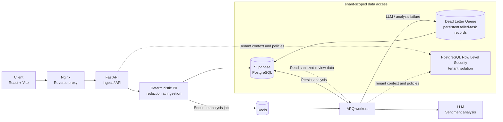

# Tenable | Enterprise SI & SERM Engine

🇬🇧 [English](README.md) | 🇷🇺 [Русский](README.ru.md) | 🇪🇸 [Español](README.es.md) | 🇨🇳 [简体中文](README.zh-CN.md) | 🇩🇪 [Deutsch](README.de.md)

Tenable is a B2B Sentiment Intelligence (SI) and Search Engine Reputation Management (SERM) platform for analyzing lawfully obtained public business feedback. It helps organizations understand sentiment, identify service-quality risks, and track reputation trends through tenant-isolated analytics.

> **Project status:** This repository contains an evolving MVP. Features and integrations may have different implementation and verification status. Do not interpret the architecture or this README as a claim of production readiness; validate the deployment, integrations, security controls, and operational procedures in your environment.

## Product Scope

Tenable is designed to turn authorized review data into structured business intelligence:

- Classify sentiment and recurring service themes.
- Highlight feedback that may require timely human attention.
- Present trends and analytics to authorized business users.
- Support asynchronous analysis workloads without blocking API requests.

Tenable is an analytics tool. It is not a reputation-manipulation service, does not promise the removal of legitimate reviews, and does not autonomously publish replies.

## Data Privacy & Compliance

### Permitted use and data sources

Tenable is intended **exclusively for lawful Sentiment Intelligence and reputation analytics**. It is not designed or authorized for “gray” scraping, access-control circumvention, or collection that violates applicable law, platform terms, or contractual restrictions.

Use only data that the customer is authorized to process, such as data supplied by the customer or obtained through an authorized official integration. Confirm that each source and collection method is permitted before enabling it. Public availability alone does not establish a lawful basis for processing or override a platform’s terms.

Automatic collection from public pages is disabled in the current application flow. Source integrations and availability can vary by deployment; verify the actual enabled configuration before use.

### PII sanitization and data minimization

The review-text ingestion path applies deterministic, code-based redaction **before review text is persisted and before it is made available for downstream LLM analysis**. The sanitizer targets supported patterns including email addresses, phone numbers, long numeric identifiers, and names that match configured contextual patterns. Redaction does not rely on an LLM.

This is a data-minimization safeguard, **not a guarantee of complete anonymization or detection of every personal data element**. Pattern-based detection can miss unrecognized formats, names without supported context, or other sensitive information. Review non-text fields and source metadata separately: text redaction does not automatically sanitize every identifier, URL, metadata field, or integration payload. Validate the exact fields stored and transmitted in the deployed configuration, and do not submit data that is not necessary and authorized for the intended analysis.

### Responsibilities and legal notice

This README describes technical controls, not legal advice, a compliance certification, or a determination that any particular processing is lawful. Customers are responsible for establishing and documenting an appropriate lawful basis, providing required notices, respecting data-subject rights, and ensuring that submitted data may be shared with Tenable and any configured subprocessors. The operator must separately assess its own obligations, including security, retention, access control, incident response, and any international data transfers.

Before production use, review applicable laws and platform terms, establish appropriate contractual arrangements, and assess the configured LLM provider’s data-processing terms, retention, and processing locations. The legal roles of the customer, operator, and service providers depend on the actual deployment and processing.

## Architecture

The diagram shows the intended processing flow. RLS policies enforce tenant-scoped access at the database layer; application and worker behavior must also be configured and tested for each deployment.

## Core Features

- **Multi-tenant data isolation:** PostgreSQL Row Level Security (RLS) policies scope business records to the authenticated tenant.
- **Deterministic PII redaction:** Supported personal-data patterns in review text are redacted during ingestion, before persistence and downstream LLM analysis.
- **Asynchronous processing:** Redis and ARQ workers handle background analysis outside the request-response path.
- **Dead Letter Queue (DLQ):** Failed AI analysis tasks can be recorded for later inspection and controlled recovery instead of being silently discarded.
- **Structured AI analysis:** Sentiment and issue classifications use typed output models and validation.
- **Operational safeguards:** The codebase includes tenant-aware database access, request tracing, rate limiting, retries, and quota-related components. Their configuration and verification remain deployment-specific.

## Technology Stack

| Area | Technologies |
|---|---|
| **Frontend** | React 18, TypeScript, Vite, Zustand |
| **Backend API** | Python 3.10+, FastAPI, Pydantic |
| **Database** | Supabase-hosted PostgreSQL, PostgreSQL RLS |
| **Async processing** | Redis, ARQ |
| **AI analysis** | LLM integration through the configured provider; provider behavior and terms depend on deployment |
| **Web / runtime** | Nginx, Docker, Docker Compose |
| **Billing components** | Stripe integration components are present in the repository; enable and validate them separately |

## Security and Operational Notes

- PostgreSQL is the supported database for the application’s tenant-isolation model; SQLite is not a substitute for validating RLS behavior.
- Apply database migrations through the repository’s migration runner rather than executing migration files ad hoc. See [`migrations/README.md`](migrations/README.md).
- Protect secrets and credentials through deployment secrets management. Do not commit `.env` files or production credentials.
- Review enabled integrations, tenant roles, network access, database policies, LLM configuration, logging, and retention settings before production use.
- Treat the DLQ as operationally sensitive data. Restrict access and define retention and replay procedures appropriate to the deployment.

## Repository Documentation

- [`README.en.md`](README.en.md) — English project overview and implementation notes.
- [`frontend/README.md`](frontend/README.md) — frontend-specific documentation.
- [`migrations/README.md`](migrations/README.md) — database migration guidance.
- [`devops/README.md`](devops/README.md) — DevOps and deployment documentation.

## License

No license grant is made by this README. Refer to the repository’s license file, if present, for the applicable terms.
