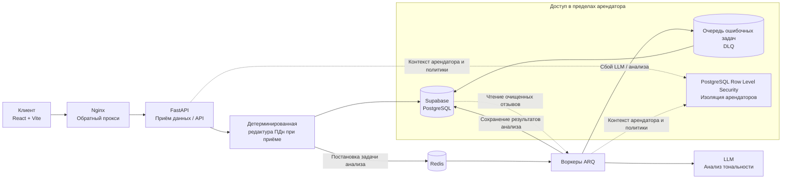

# Tenable | Enterprise SI & SERM Engine

🇬🇧 [English](README.md) | 🇷🇺 [Русский](README.ru.md) | 🇪🇸 [Español](README.es.md) | 🇨🇳 [简体中文](README.zh-CN.md) | 🇩🇪 [Deutsch](README.de.md)

Tenable — B2B-платформа Sentiment Intelligence (SI) и управления репутацией в поисковых системах (SERM) для анализа правомерно полученных публичных отзывов о компаниях. Платформа помогает организациям оценивать тональность отзывов, выявлять риски качества обслуживания и отслеживать динамику репутации с изоляцией данных арендаторов.

> **Статус проекта:** в репозитории находится развивающийся MVP. Степень готовности и проверки отдельных функций и интеграций может различаться. Архитектура и описание в README не являются заявлением о готовности к промышленной эксплуатации. Перед использованием проверьте развёртывание, интеграции, меры безопасности и операционные процедуры в своей среде.

## Назначение продукта

Tenable преобразует разрешённые к обработке данные отзывов в структурированную деловую аналитику:

- Классифицирует тональность и повторяющиеся темы, связанные с обслуживанием.
- Выделяет отзывы, требующие своевременного внимания сотрудников.
- Показывает динамику и аналитику уполномоченным пользователям компании.
- Выполняет анализ асинхронно, не блокируя обработку API-запросов.

Tenable — аналитический инструмент. Он не предназначен для манипулирования репутацией, не обещает удаление достоверных отзывов и не публикует ответы автоматически.

## Конфиденциальность данных и соответствие требованиям

### Допустимое использование и источники данных

Tenable предназначен **исключительно для законной аналитики тональности (Sentiment Intelligence) и репутации**. Система не предназначена и не уполномочена для «серого» скрейпинга, обхода средств контроля доступа или сбора данных с нарушением применимого законодательства, условий платформ или договорных ограничений.

Используйте только данные, которые заказчик вправе обрабатывать, например предоставленные им данные или данные, полученные через официальную интеграцию с надлежащей авторизацией. До включения источника убедитесь, что соответствующий источник и способ сбора разрешены. Общедоступность данных сама по себе не создаёт законного основания для обработки и не отменяет условия платформы.

В текущем потоке приложения автоматический сбор с публичных страниц отключён. Наличие и доступность интеграций могут зависеть от конфигурации развёртывания; перед использованием проверьте, какие источники фактически включены.

### Санитизация персональных данных и минимизация данных

На пути приёма текста отзывов применяется детерминированное программное удаление поддерживаемых шаблонов **до сохранения текста отзыва и до его передачи для дальнейшего анализа LLM**. Санитайзер выявляет, в частности, адреса электронной почты, номера телефонов, длинные цифровые идентификаторы и имена, соответствующие настроенным контекстным шаблонам. Для этой редактуры LLM не используется.

Это мера минимизации данных, **а не гарантия полной анонимизации или обнаружения всех персональных данных**. Шаблонное распознавание может не выявить неизвестные форматы, имена без поддерживаемого контекста и другие чувствительные сведения. Отдельно учитывайте нетекстовые поля отзывов и метаданные источников: очистка текста автоматически не санитизирует все идентификаторы, URL, поля метаданных и полезные нагрузки интеграций. Проверьте, какие именно поля сохраняются и передаются в используемой конфигурации; не передавайте данные, которые не нужны для анализа или обработка которых не разрешена.

### Обязанности сторон и юридическая оговорка

Этот README описывает технические меры, а не является юридической консультацией, подтверждением соответствия требованиям или заключением о законности конкретной обработки. Заказчик отвечает за установление и документирование надлежащего правового основания, предоставление обязательных уведомлений, соблюдение прав субъектов данных и наличие права передавать данные Tenable и настроенным субобработчикам. Оператор должен отдельно оценить собственные обязанности, включая безопасность, сроки хранения, контроль доступа, реагирование на инциденты и возможную международную передачу данных.

Перед промышленным использованием проверьте применимое законодательство и условия платформ, оформите необходимые договорные отношения и оцените условия обработки данных, сроки хранения и местоположение обработки у выбранного поставщика LLM. Юридические роли заказчика, оператора и поставщиков услуг зависят от фактической конфигурации и обработки.

## Архитектура

Диаграмма отражает предполагаемый поток обработки. Политики RLS ограничивают доступ к данным на уровне базы данных; для каждого развёртывания необходимо также настроить и проверить поведение приложения и воркеров.

## Основные функции

- **Мультитенантная изоляция данных:** политики PostgreSQL Row Level Security (RLS) ограничивают бизнес-данные аутентифицированным арендатором.
- **Детерминированная редактура ПДн:** поддерживаемые шаблоны персональных данных удаляются из текста отзыва при приёме — до сохранения и передачи для анализа LLM.
- **Асинхронная обработка:** Redis и воркеры ARQ выполняют фоновые задачи отдельно от синхронного пути API.
- **Очередь ошибочных задач (DLQ):** неуспешные задачи анализа ИИ могут сохраняться для последующего изучения и контролируемого повторного запуска, а не теряться незаметно.
- **Структурированный анализ ИИ:** тональность и категории проблем проходят валидацию типизированных моделей.
- **Операционные меры:** в кодовой базе есть компоненты для работы с tenant-контекстом, трассировки запросов, ограничения частоты запросов, повторных попыток и квот. Их конфигурацию и работоспособность необходимо проверять отдельно для каждого развёртывания.

## Технологический стек

| Область | Технологии |
|---|---|
| **Frontend** | React 18, TypeScript, Vite, Zustand |
| **Backend API** | Python 3.10+, FastAPI, Pydantic |
| **База данных** | PostgreSQL на Supabase, PostgreSQL RLS |
| **Асинхронная обработка** | Redis, ARQ |
| **Анализ ИИ** | Интеграция с LLM через настроенного поставщика; поведение и условия зависят от конфигурации |
| **Веб-сервер и среда выполнения** | Nginx, Docker, Docker Compose |
| **Компоненты биллинга** | В репозитории присутствуют компоненты интеграции Stripe; включайте и проверяйте их отдельно |

## Безопасность и эксплуатация

- Для модели изоляции арендаторов приложения требуется PostgreSQL; SQLite не заменяет проверку работы RLS.
- Применяйте миграции базы данных через миграционный скрипт репозитория, а не вручную. См. [`migrations/README.md`](migrations/README.md).
- Храните секреты и учётные данные средствами управления секретами в среде развёртывания. Не коммитьте `.env` и производственные секреты.
- Перед промышленным запуском проверьте активные интеграции, роли арендаторов, сетевой доступ, политики базы данных, настройки LLM, журналирование и сроки хранения.
- Считайте DLQ хранилищем чувствительных с операционной точки зрения данных. Ограничьте доступ и определите подходящие процедуры хранения и повторной обработки.

## Документация репозитория

- [`README.md`](README.md) — основная версия на английском языке.
- [`frontend/README.md`](frontend/README.md) — документация frontend.
- [`migrations/README.md`](migrations/README.md) — руководство по миграциям базы данных.
- [`devops/README.md`](devops/README.md) — документация DevOps и развёртывания.

## Лицензия

Этот README не предоставляет лицензионных прав. Условия использования, если они установлены, указаны в файле лицензии репозитория.
