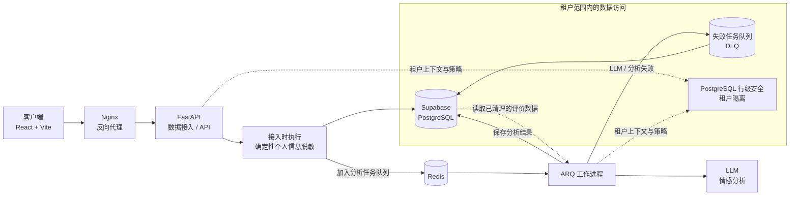

# Tenable | Enterprise SI & SERM Engine

🇬🇧 [English](README.md) | 🇷🇺 [Русский](README.ru.md) | 🇪🇸 [Español](README.es.md) | 🇨🇳 [简体中文](README.zh-CN.md) | 🇩🇪 [Deutsch](README.de.md)

Tenable 是一款面向 B2B 的 Sentiment Intelligence（SI，情感洞察）与搜索引擎声誉管理（SERM）平台，用于分析依法获取的公开商业评价。平台帮助组织了解评价情绪、发现服务质量风险，并通过租户隔离的分析跟踪声誉趋势。

> **项目状态：** 本仓库包含一个持续演进中的 MVP。不同功能和集成的实现与验证状态可能各不相同。请勿将本文档或架构描述视为已达到生产就绪状态的声明。请在自己的环境中验证部署、集成、安全控制和运维流程。

## 产品范围

Tenable 旨在将获准处理的评价数据转化为结构化商业洞察：

- 对情绪和反复出现的服务主题进行分类。
- 标记可能需要工作人员及时关注的反馈。
- 向获授权的业务用户展示趋势和分析结果。
- 支持异步分析任务，避免阻塞 API 请求。

Tenable 是一款分析工具，不用于操纵声誉，不承诺删除真实评价，也不会自主发布回复。

## 数据隐私与合规

### 允许的用途与数据来源

Tenable **仅用于合法的情感洞察（Sentiment Intelligence）与声誉分析**。本系统并非为“灰色”抓取、绕过访问控制，或违反适用法律、平台条款及合同限制的数据收集而设计或授权。

仅使用客户有权处理的数据，例如客户提供的数据，或通过已获授权的官方集成取得的数据。启用数据来源前，请确认该来源及其采集方式均获准使用。数据公开可见本身并不能构成处理数据的合法依据，也不会取代平台条款。

当前应用流程已禁用从公开网页自动采集数据。可用数据源和集成可能因部署而异；使用前请核实实际启用的配置。

### 个人信息清理与数据最小化

在评价文本接入流程中，系统会使用基于代码的确定性脱敏规则，**在评价文本写入数据库之前、以及将其提供给下游 LLM 分析之前**执行清理。清理程序针对受支持的模式，包括电子邮件地址、电话号码、较长的数字标识符，以及符合已配置上下文模式的姓名。该脱敏过程不依赖 LLM。

这是一项数据最小化措施，**并不保证完全匿名化，也不保证能够发现所有个人信息**。基于模式的检测可能遗漏未识别的格式、缺少受支持上下文的姓名或其他敏感信息。评价中的非文本字段和来源元数据需要单独审查：文本清理不会自动清理所有标识符、URL、元数据字段或集成载荷。请核实部署配置中实际存储和传输的字段；不要提交非分析所必需或未经授权处理的数据。

### 责任与法律声明

本 README 介绍的是技术控制措施，不构成法律意见、合规认证，也不对任何具体数据处理活动是否合法作出判断。客户负责确定并记录适当的合法处理依据、提供所需告知、尊重数据主体权利，并确保可以向 Tenable 及已配置的次级处理方提供所提交的数据。运营方也必须单独评估自身义务，包括安全、保留期限、访问控制、事件响应以及可能发生的国际数据传输。

投入生产使用前，请审查适用法律和平台条款，订立必要的合同安排，并评估所配置 LLM 提供商的数据处理条款、保留期限和处理地点。客户、运营方和服务提供商的法律角色取决于实际部署和数据处理情况。

## 架构

该图展示的是预期处理流程。RLS 策略在数据库层限制租户数据访问；每个部署环境还必须配置并验证应用及工作进程的行为。

## 核心功能

- **多租户数据隔离：** PostgreSQL 行级安全（RLS）策略将业务数据限制在已认证的租户范围内。
- **确定性个人信息脱敏：** 在接入阶段对评价文本中受支持的个人信息模式进行清理，先于数据持久化和下游 LLM 分析。
- **异步处理：** Redis 与 ARQ 工作进程在后台处理任务，不占用同步 API 请求路径。
- **失败任务队列（DLQ）：** SI 分析失败的任务可以记录下来，供后续检查和受控恢复，而不是被静默丢弃。
- **结构化 SI 分析：** 通过类型化输出模型和校验机制验证情感及问题分类。
- **运维保护措施：** 代码库包含租户上下文、请求追踪、速率限制、重试和配额相关组件。具体配置与验证需针对各部署环境完成。

## 技术栈

| 领域 | 技术 |
|---|---|
| **前端** | React 18、TypeScript、Vite、Zustand |
| **后端 API** | Python 3.10+、FastAPI、Pydantic |
| **数据库** | Supabase 托管的 PostgreSQL、PostgreSQL RLS |
| **异步处理** | Redis、ARQ |
| **SI 分析** | 通过已配置提供商集成 LLM；具体行为和条款取决于部署配置 |
| **Web / 运行环境** | Nginx、Docker、Docker Compose |
| **计费组件** | 仓库中包含 Stripe 集成组件；请单独启用并验证 |

## 安全与运维说明

- 应用的租户隔离模型要求使用 PostgreSQL；SQLite 不能替代对 RLS 行为的验证。
- 请通过仓库提供的迁移工具应用数据库迁移，不要手动执行迁移文件。参见 [`migrations/README.md`](migrations/README.md)。
- 使用部署环境的密钥管理机制保护秘密和凭据。不要提交 `.env` 文件或生产凭据。
- 投入生产前，请检查已启用的集成、租户角色、网络访问、数据库策略、LLM 配置、日志和数据保留设置。
- 将 DLQ 视为具有运维敏感性的存储。限制访问，并根据部署需求制定保留和重放流程。

## 仓库文档

- [`README.md`](README.md) — 英文主版本。
- [`frontend/README.md`](frontend/README.md) — 前端专属文档。
- [`migrations/README.md`](migrations/README.md) — 数据库迁移指南。
- [`infra/devops/README.md`](infra/devops/README.md) — DevOps 与部署文档。

## 许可证

本 README 不授予任何许可权利。适用条款请参阅仓库中的许可证文件（如有）。
